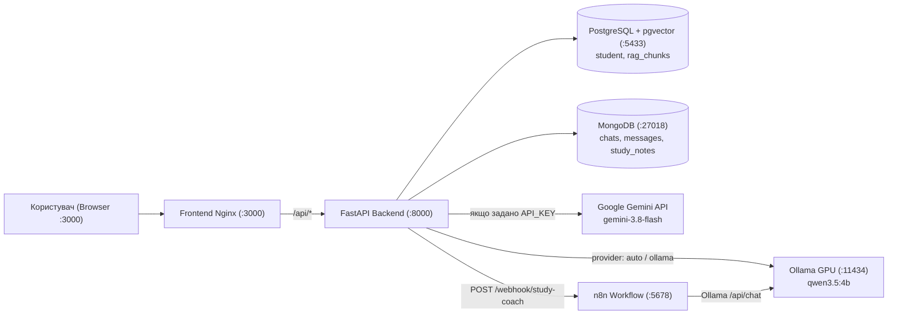

# CMS Project (PVI) — Навчальна платформа з AI-асистентом, RAG та n8n

Веб-застосунок для керування студентами, персональних AI-чатів із завантаженням PDF-матеріалів (RAG), генерації інтерактивних тестів та автоматизації розбору помилок через **n8n** і локальну LLM (**Ollama** / **Google Gemini**).

---

## 1. З чого складається система

Весь стек розгортається у 7 Docker-контейнерах у спільній мережі `cms-network` ([docker-compose.yml](docker-compose.yml)):

| Сервіс | Контейнер | Технологія / Образ | Порт на хості | Призначення |
| :--- | :--- | :--- | :--- | :--- |
| **Frontend** | `frontend-cms` | `nginx:alpine` + Vanilla JS/HTML/CSS | `3000` | Веб-інтерфейс (`Login`, `Dashboard`, `Students`, `Messages`, `Tests`) та reverse proxy `/api/` → `backend:8000` |
| **Backend** | `backend-cms` | Python 3.13 + FastAPI + SQLModel + Beanie (`uv`) | `8000` | REST API, WebSockets, AI-агент (Tool Calling), PDF-парсер (`pypdf`), генератор тестів, MCP-сервер (`/mcp`) |
| **PostgreSQL** | `postgres-cms` | `pgvector/pgvector:pg16` | `5433` | Таблиця студентів (`student`) та векторне сховище RAG (`rag_chunks`, `Vector(768)` з HNSW-індексом) |
| **MongoDB** | `mongo-cms` | `mongo:latest` | `27018` | Персональні чати (`chats`), історія повідомлень (`messages`) та збережені шпаргалки (`study_notes`) |
| **Ollama** | `ollama-cms` | `ollama/ollama:latest` (GPU/CUDA) | `11434` | Локальна LLM (`qwen3.5:4b`) з підтримкою NVIDIA GPU |
| **n8n** | `n8n-cms` | `docker.n8n.io/n8nio/n8n:latest` | `5678` | Візуальний оркестратор сценарію `AI Study Coach` після здачі тестів |
| **pgAdmin** | `pgadmin-cms` | `dpage/pgadmin4:latest` | `5050` | Веб-GUI для перегляду та запитів до PostgreSQL (`pgadmin/servers.json`) |

### Схема взаємодії компонентів



---

## 2. Основні можливості

* **Студенти та авторизація:**
  * Базова HTTP-автентифікація за ім'ям/прізвищем та паролем (дата народження у форматі `ДД.ММ.РРРР`).
  * CRUD операції над студентами, пошук, пагінація та онлайн-статуси через WebSocket.
* **Персональні AI-чати та приватний RAG (`Messages`):**
  * Кожен користувач створює власні чати з довільною назвою (дисципліна/тема — необов'язкова).
  * Завантаження `.pdf` через кнопку **`📎 PDF`** (витяг тексту через `pypdf`, нарізка по межах слів, ембединги у `rag_chunks` в PostgreSQL `pgvector`).
  * Сувора ізоляція даних за `student_id` та `chat_id` (із `ON DELETE CASCADE` при видаленні студента).
  * AI-агент уміє шукати у ваших PDF та викликати SQL-інструменти по базі студентів (`search_students`, `get_group_students`, `get_system_stats`).
* **AI-провайдери (Ollama GPU ↔ Google Gemini):**
  * За замовчуванням (`APP_CONFIG__AI__PROVIDER=auto`) при порожньому `APP_CONFIG__AI__API_KEY` використовується локальна **Ollama (`qwen3.5:4b`)** на відеокарті.
  * Щоб перейти на **Google Gemini**, достатньо вставити ключ у `APP_CONFIG__AI__API_KEY` у файлі `.env` і перезапустити `backend`.
  * Якщо обидва провайдери недоступні — працює резервний локальний алгоритм (`Offline Fallback`).
* **Генератор тестів та `n8n AI Study Coach` (`Tests`):**
  * Генерація `1–10` унікальних тестових запитань по PDF вибраного чату або за довільною темою (захист від повторів `previous_questions` + збалансована довжина варіантів).
  * Після натискання **«Перевірити результат»** кнопка **«🎯 Створити шпаргалку (n8n AI)»** запускає воркфлоу `n8n/workflows/study_coach.json`:
    * `IF Score < 70%` → детальний розбір кожної помилки + шпаргалка для повторення (`remedial`).
    * `>= 70%` → ключові тези теми + 1 поглиблене питання для закріплення (`advanced`).
  * Шпаргалки зберігаються в MongoDB (`study_notes`) окремо для кожного студента, доступні у блоці **«📚 Мої збережені шпаргалки»** та експортуються у `.md`.
* **MCP-сервер (Model Context Protocol):**
  * JSON-RPC 2.0 ендпоінт `POST http://localhost:8000/mcp` для підключення зовнішніх AI-клієнтів (Cursor, Claude Desktop тощо).

---

## 3. Як запустити систему

### Крок 0. Вимоги
* Встановлений і запущений **Docker Desktop**.
* Для локальної генерації на відеокарті: актуальний драйвер NVIDIA на Windows (Docker Desktop автоматично прокидає GPU у WSL2).
  > *Якщо на ПК немає відеокарти NVIDIA*, видаліть або закоментуйте секцію `deploy:` у сервісі `ollama` в [docker-compose.yml](docker-compose.yml) — Ollama працюватиме на CPU.

### Крок 1. Налаштування змінних середовища (`.env`)
Скопіюйте шаблон [`.env.example`](.env.example) у `.env` (якщо `.env` ще не створений):
```powershell
Copy-Item .env.example .env
```

Основні параметри `.env`:
* `APP_CONFIG__AI__PROVIDER=auto` — `auto` (Gemini якщо є ключ, інакше Ollama), або примусово `ollama` / `gemini`.
* `APP_CONFIG__AI__OLLAMA_MODEL=qwen3.5:4b` — локальна модель Ollama.
* `APP_CONFIG__AI__API_KEY=` — залиште порожнім для роботи через Ollama, або вставте ключ із Google AI Studio для Gemini.
* Порти хоста: `FRONTEND_HOST_PORT=3000`, `BACKEND_HOST_PORT=8000`, `POSTGRES_HOST_PORT=5433`, `MONGO_HOST_PORT=27018`, `PGADMIN_HOST_PORT=5050`, `N8N_HOST_PORT=5678`, `OLLAMA_HOST_PORT=11434`.

### Крок 2. Збірка та запуск контейнерів
```bash
docker compose up --build -d
```

Перевірка, що всі сервіси піднялися:
```bash
docker compose ps
```

### Крок 3. Завантаження моделі в Ollama (один раз)
```bash
docker compose exec ollama ollama pull qwen3.5:4b
```

### Крок 4. Заповнення бази тестовими студентами (перший запуск)
```bash
docker compose exec backend python app/actions/populate_student.py
```

Подивитися логіни та паролі згенерованих студентів:
```bash
docker compose exec postgres psql -U postgres -d CMS -c "SELECT id, first_name, last_name, password, birthday FROM student ORDER BY id LIMIT 5;"
```

### Крок 5. Імпорт та активація воркфлоу в n8n (один раз)
1. Імпортуйте шаблон воркфлоу в контейнер `n8n`:
   ```bash
   docker compose exec n8n n8n import:workflow --input=/data/workflows/study_coach.json
   ```
2. Відкрийте [http://localhost:5678](http://localhost:5678), створіть локальний профіль (при першому вході).
3. Відкрийте воркфлоу **AI Study Coach (Test Review & Cheat Sheet)** і натисніть **`Publish`** у правому верхньому куті.
   *(Поки воркфлоу не опублікований, бекенд автоматично виконує ту саму логіку як fallback).*

---

## 4. Корисні адреси

* **Головна (вхід):** [http://localhost:3000](http://localhost:3000)
* **Чати та PDF RAG:** [http://localhost:3000/messages_page/messages.html](http://localhost:3000/messages_page/messages.html)
* **Тести та AI Study Coach:** [http://localhost:3000/tests_page/tests.html](http://localhost:3000/tests_page/tests.html)
* **Swagger API Docs:** [http://localhost:8000/docs](http://localhost:8000/docs)
* **AI Status (активна модель, кількість RAG-фрагментів):** [http://localhost:8000/api/v1/ai/status](http://localhost:8000/api/v1/ai/status)
* **Health Check:** [http://localhost:8000/health](http://localhost:8000/health)
* **MCP Server:** `http://localhost:8000/mcp`
* **pgAdmin (PostgreSQL GUI):** [http://localhost:5050](http://localhost:5050) (`admin@cms.com` / `admin`)
* **n8n Workflows:** [http://localhost:5678](http://localhost:5678)

---

## 5. Корисні команди керування

```bash
# Перевірити, чи модель завантажена на GPU
docker compose exec ollama ollama ps

# Переглянути логи бекенду або Ollama
docker compose logs -f backend ollama

# Зупинити всі контейнери (дані та моделі зберігаються у volumes)
docker compose down

# Повне очищення контейнерів разом із даними (БД та завантажені моделі Ollama!)
docker compose down -v
```

---

## 6. Структура репозиторію

```text
├── docker-compose.yml          # Опис усіх 7 Docker-сервісів і volumes
├── .env.example                # Шаблон змінних середовища
├── n8n/workflows/
│   └── study_coach.json        # Воркфлоу n8n для розбору помилок після тестів
├── pgadmin/
│   └── servers.json            # Автопідключення pgAdmin до PostgreSQL
├── front-end/
│   ├── nginx.conf              # Роздача статики без кешу + proxy /api/
│   ├── index.html, login.js    # Авторизація
│   ├── app.js, main.css        # Спільна шапка, навігація, WebSocket, Sign out
│   ├── dashboard_page/         # Dashboard
│   ├── students_page/          # Таблиця та CRUD студентів
│   ├── messages_page/          # Персональні AI/P2P чати + завантаження PDF
│   └── tests_page/             # Генератор тестів (1–10), n8n Study Coach і шпаргалки
└── back-end/
    ├── Dockerfile              # Python 3.13-slim + uv
    ├── pyproject.toml          # Залежності (FastAPI, SQLModel, pgvector, Beanie, pypdf...)
    └── app/
        ├── main.py             # Точка входу FastAPI, CORS, /health, /mcp
        ├── actions/            # Скрипт генерації тестових студентів (populate_student.py)
        ├── core/               # Конфіг, підключення Postgres/Mongo, SQLModel та Beanie моделі
        └── api/v1/
            ├── students/       # API студентів та логіну
            ├── messages/       # API чатів і WebSocket
            └── ai/             # agent.py, rag.py (pgvector), quiz.py, coach.py, pdf_parser.py, mcp_server.py
```
